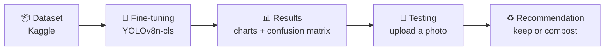
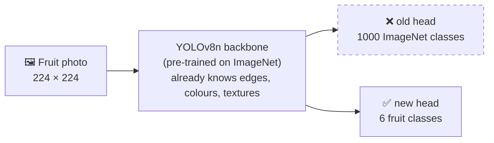
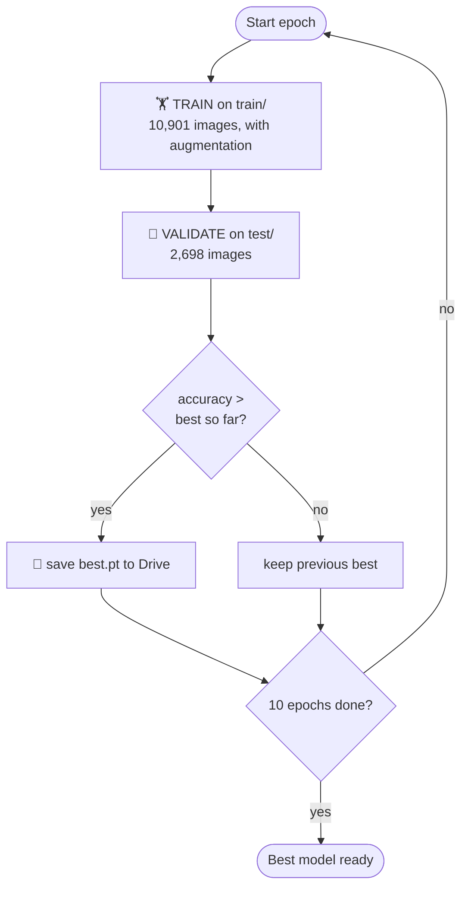
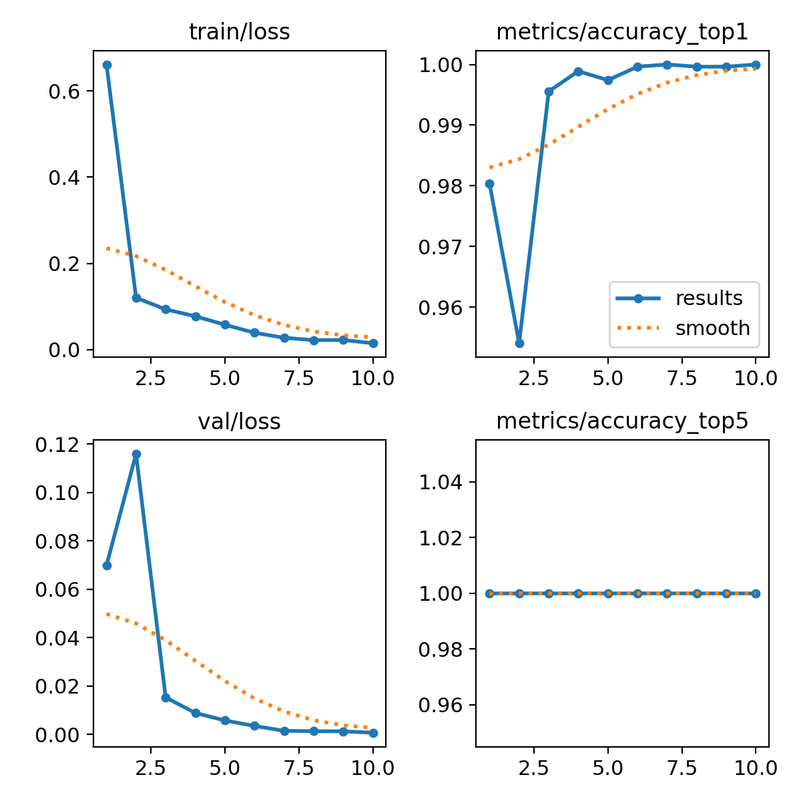
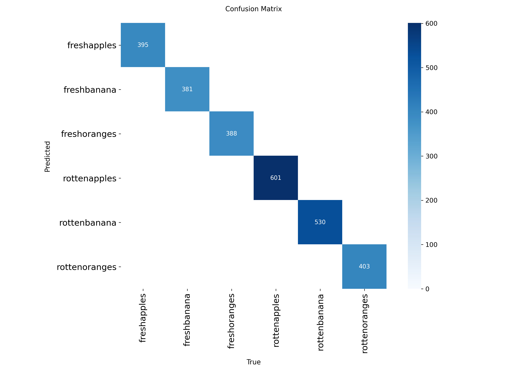
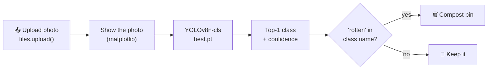
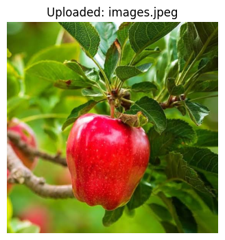

# 🍎 FreshScan — Fresh or Rotten Fruit Detector

FreshScan looks at a photo of a fruit and tells you whether it is **fresh** or **rotten**. It then **recommends what to do with it**: keep it, or put it in the compost bin.

📓 [`freshscan.ipynb`](freshscan.ipynb) · [](https://colab.research.google.com/github/asilbek1301/fresh_scan/blob/main/freshscan.ipynb)

It is the next step after my [Menu Detector](https://github.com/asilbek1301/computer_vision) project. The idea is the same (photo → class → percentage), but this time it uses a **YOLOv8 classification model**, a ready-made dataset, and a small **recommendation engine** on top, in the spirit of "smart waste sorting" apps.



**Final result:** a fine-tuned **YOLOv8n-cls** model (3.0 MB) that classifies **6 classes** with **100% top-1 accuracy on the test set: 2,698 / 2,698 images correct**.

| 🍎 apple | 🍌 banana | 🍊 orange |
|:---:|:---:|:---:|
| fresh · rotten | fresh · rotten | fresh · rotten |

---

## Contents

1. [Repository structure](#repository-structure)
2. [From Menu Detector to FreshScan](#from-menu-detector-to-freshscan)
3. [Step 1 — Dataset](#step-1--dataset)
4. [Step 2 — Model: YOLOv8n-cls](#step-2--model-yolov8n-cls)
5. [Step 3 — Training](#step-3--training)
6. [Step 4 — Results](#step-4--results)
7. [Step 5 — Testing and recommendation](#step-5--testing-and-recommendation)
8. [How to run it](#how-to-run-it)
9. [Tech stack](#tech-stack)
10. [Known limitations and next steps](#known-limitations-and-next-steps)

---

## Repository structure

```
fresh_scan/
├── freshscan.ipynb              # dataset → training → results → upload & predict
├── assets/
│   ├── results.png              # loss + accuracy per epoch
│   ├── confusion_matrix.png     # test set, 6 × 6
│   └── prediction_example.png   # a real uploaded photo
└── README.md
```

The notebook was written to run in **Google Colab** with a **T4 GPU**.

---

## From Menu Detector to FreshScan

Same idea, less code, one extra step at the end:

| | 🍽️ Menu Detector | 🍎 FreshScan |
|---|---|---|
| Task | 5 dishes | 3 fruits × fresh / rotten = 6 classes |
| Data | Food-101 + images scraped from Bing | One ready-made Kaggle dataset |
| Model | MobileNetV2 (torchvision) | YOLOv8n-cls (Ultralytics) |
| Code I write | `FoodDataset`, transforms, `DataLoader`, training loop | One `model.train(...)` call |
| Data augmentation | none | built in (RandAugment) |
| Best model saved to | `/content` (lost when Colab closes) | Google Drive (kept) |
| Charts | none | training curves + confusion matrix, automatic |
| After the prediction | class name only | **recommendation**: 🧺 keep it / 🗑️ compost bin |

---

## Step 1 — Dataset

**Source:** [Fruits fresh and rotten for classification](https://www.kaggle.com/datasets/sriramr/fruits-fresh-and-rotten-for-classification) on Kaggle, downloaded straight into Colab with `kagglehub`:

```python
import kagglehub
path = kagglehub.dataset_download("sriramr/fruits-fresh-and-rotten-for-classification")
```

The dataset already comes split into folders, **one folder per class**. YOLO reads the class names from the folder names, so no custom `Dataset` class is needed.

```
dataset/
├── train/
│   ├── freshapples/   freshbanana/   freshoranges/
│   └── rottenapples/  rottenbanana/  rottenoranges/
└── test/
    └── (same 6 folders)
```

| Class | Train | Test |
|-------|:-----:|:----:|
| 🍎 freshapples | 1,693 | 395 |
| 🍌 freshbanana | 1,581 | 381 |
| 🍊 freshoranges | 1,466 | 388 |
| 🍎 rottenapples | 2,342 | 601 |
| 🍌 rottenbanana | 2,224 | 530 |
| 🍊 rottenoranges | 1,595 | 403 |
| **Total** | **10,901** | **2,698** |

```
13,599 images  ──►  10,901 for training  (80%)
               └►    2,698 for testing   (20%)
```

The classes are fairly balanced (the smallest has 1,466 training images, the largest 2,342), unlike Menu Detector where kebab had only 29.

> There is no separate `val/` folder, so YOLO uses `test/` to check accuracy after every epoch.

---

## Step 2 — Model: YOLOv8n-cls

YOLO is best known for drawing boxes around objects, but it also has a **classification** version (`-cls`): one image in, one class out. Exactly what Menu Detector did.

- **`n` = nano**, the smallest and fastest YOLOv8 size.
- **Pre-trained on ImageNet** (1000 classes), just like MobileNetV2 was.
- Only the last layer is replaced: **1000 classes → 6 classes**.



From the training log:

| | Value |
|---|---|
| Layers | 56 |
| Parameters | **1,445,974** (lighter than MobileNetV2's ~3.5M) |
| Compute | 3.4 GFLOPs |
| Pre-trained weights reused | 156 / 158 (only the 2 head tensors are new) |

```python
from ultralytics import YOLO
model = YOLO('yolov8n-cls.pt')
```

---

## Step 3 — Training

In Menu Detector I wrote the 5-step training loop by hand (forward → loss → zero_grad → backward → step). Ultralytics runs the same loop inside one call:

```python
model.train(
    data=DATA_DIR,      # folder with train/ and test/
    epochs=10,
    imgsz=224,
    batch=32,
    project=SAVE_DIR,   # /content/drive/MyDrive/freshscan
    name='yolo_cls',
    exist_ok=True
)
```

| Setting | Value | Meaning |
|---------|-------|---------|
| Epochs | 10 | the model reads the whole dataset 10 times |
| Image size | 224 × 224 | same size as MobileNetV2 |
| Batch size | 32 | 32 images go into the model at once |
| Optimizer | `AdamW(lr=0.001, momentum=0.9)` | chosen automatically by Ultralytics (`optimizer=auto`) |
| Augmentation | `randaugment` | random flips, scaling and colour changes, so the model doesn't memorise exact photos |
| Best model | `yolo_cls/weights/best.pt` | saved automatically, like "save new best model" in Menu Detector |



> ⚠️ **Use a GPU.** On a **Tesla T4** one epoch took about **1 min 20 s** and all 10 epochs took **16 minutes**. My first try ran on a CPU runtime by mistake: about **11 minutes per epoch** (1.9 s per batch × 341 batches). The notebook now checks `torch.cuda.is_available()` before training.

---

## Step 4 — Results

**Training results (10 epochs, Tesla T4):**

| Epoch | Train loss | Top-1 accuracy | |
|:-----:|:----------:|:--------------:|---|
| 1 | 0.6613 | 98.0% | `████████    ` |
| 2 | 0.1201 | 95.4% | `███         ` |
| 3 | 0.0932 | 99.6% | `███████████ ` |
| 4 | 0.0774 | 99.9% | `████████████` |
| 5 | 0.0576 | 99.7% | `███████████▌` |
| 6 | 0.0391 | 100%\* | `████████████` |
| 7 | 0.0274 | 100%\* | `████████████` |
| 8 | 0.0219 | 100%\* | `████████████` |
| 9 | 0.0222 | 100%\* | `████████████` |
| 10 | 0.0148 | 100%\* | `████████████` |

each █ = 0.5% above 94% · \* the log rounds to `1`, which means at most 1 wrong image out of 2,698

- **Epoch 2 dip:** accuracy fell to 95.4% for one epoch, then jumped back. Same kind of up-and-down as in Menu Detector, but much smaller, and it settles from epoch 6.
- **Loss keeps going down** for all 10 epochs, from 0.66 to 0.015.
- **Final check of `best.pt`** on the test set: **2,698 / 2,698 correct (100%)**.
- **Speed:** **0.4 ms** per image on the T4 GPU.



**Confusion matrix** (rows = predicted, columns = true). Every image lands on the diagonal, so the model never mixed up a fruit or confused fresh with rotten:



---

## Step 5 — Testing and recommendation

The last cell turns the model into a small app inside Colab:



The **recommendation engine** is a simple rule on the predicted class name:

```python
def recommend(class_name):
    fruit = class_name.replace('fresh', '').replace('rotten', '').rstrip('s')   # 'rottenapples' → 'apple'
    if 'rotten' in class_name:
        return '🗑️ Compost bin', f'This {fruit} is rotten. Put it in the organic/compost bin.'
    return '🧺 Keep it', f'This {fruit} is fresh. Eat it or store it in the fridge.'
```

**Real example from the notebook.** I uploaded a photo of an apple still hanging on the tree, with leaves around it. The training photos mostly show fruit on a plain background, and the model still got it right:



```
Prediction: freshapples (99.76%)
Recommended: 🧺 Keep it
Tip: This apple is fresh. Eat it or store it in the fridge.
```

---

## How to run it

1. Click the **Open in Colab** badge at the top.
2. Switch to a GPU: **Runtime → Change runtime type → T4 GPU**.
3. Run the cells from top to bottom. The **Check GPU** cell must print `True`.
4. If Kaggle asks you to log in, add `KAGGLE_USERNAME` and `KAGGLE_KEY` in **Colab Secrets** (🔑 icon on the left).
5. Training saves the best model to `MyDrive/freshscan/yolo_cls/weights/best.pt`.
6. Run the last cell and upload a fruit photo.

> The trained weights file (`best.pt`, 3.0 MB) is saved to Google Drive, not to this repository. Run the training cell to create it (about 16 minutes on a T4).

---

## Tech stack

| Tool | Used for |
|------|----------|
| **Python** | everything |
| **Google Colab** | running the notebook, free T4 GPU |
| **Google Drive** | keeping the trained model after the session ends |
| **Kaggle + kagglehub** | downloading the dataset |
| **Ultralytics YOLOv8** | pre-trained classification model, training, charts |
| **PyTorch** | runs underneath Ultralytics |
| **Pillow (PIL)** | opening uploaded images |
| **Matplotlib** | showing uploaded photos |

---

## Known limitations and next steps

- **100% is partly a sign of an easy dataset.** Fresh and rotten fruit look very different, and the photos are clean. Real-world photos will not always be this easy.
- **The test set is also the validation set.** YOLO picks the best epoch using `test/`, so the final accuracy is a little optimistic. A separate `val/` folder would give a more honest score.
- **Only 3 fruits.** Apples, bananas and oranges. Any other fruit will still be forced into one of the 6 classes.
- **Clean dataset photos.** Most images show one fruit on a plain background. Photos from a real fridge or market (many fruits, bad light) may be harder.
- **The recommendation is a fixed rule.** It does not estimate how many days a fresh fruit will last.
- **Next steps:**
  - a **FastAPI** backend + **React** dashboard with a "Recommended bin" card;
  - **live webcam** predictions with OpenCV;
  - **YOLOv8 detection** (boxes) to check several fruits in one photo;
  - more fruits and vegetables.
